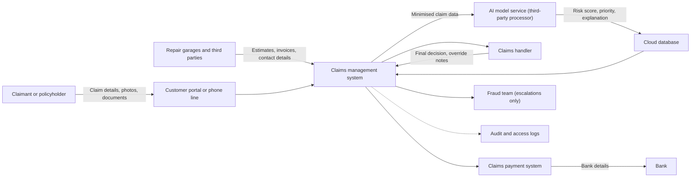

# Data Flow Map

**Independent simulation.** Fictional insurer; no real personal data.

## Controls at each point
| Flow | Data | Control (proposed) |
|---|---|---|
| Portal to claims system | D01 to D04 | Encryption in transit; input validation |
| Claims system to AI service | D16 (minimised) | Only needed fields sent; contract with processor |
| AI output to handler | D07, D17 | Role-based access; handler can override |
| Customer call to recording platform | D13 | Callers told the call is recorded; playback limited to authorised staff; retention set by purpose |
| Claimant or medical provider to document store | D05 | Restricted access; encryption in transit and at rest; excluded from AI input unless necessity is documented in the DPIA |
| Claims system to payment system and bank | D09 | Payment staff only; approval step before payment; access logged |
| Claims system to fraud team | D08 | Escalation only after handler review; access logged; a fraud flag is never treated as proof |
## Special category data (D05; also possibly D12 and D13)
Health information can enter through injury reports, medical documents, emails and call recordings. It travels from the claimant or medical provider through the portal or phone line to the claims system, then to the document store, and is seen only by authorised handlers.

It should be restricted at every step:
- Access limited to named roles, reviewed regularly.
- Not sent to the AI model unless necessity is documented and justified in the DPIA.
- Encrypted in transit and at rest.
- Access logged and monitored.
- Not copied into general emails or notes.
  C -->|"D05 health data, restricted"| M["Document store (restricted access)"]
  M --> F
  style M fill:#fde2e2,stroke:#c00
