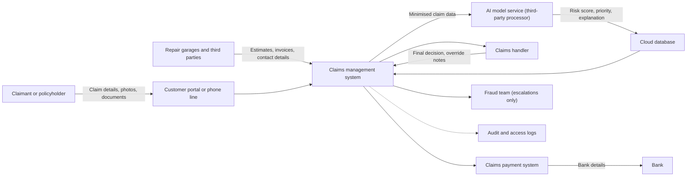

# Data Flow Map

**Independent simulation.** Fictional insurer; no real personal data.

## Controls at each point
| Flow | Data | Control (proposed) |
|---|---|---|
| Portal to claims system | D01 to D04 | Encryption in transit; input validation |
| Claims system to AI service | D16 (minimised) | Only needed fields sent; contract with processor |
| AI output to handler | D07, D17 | Role-based access; handler can override |
